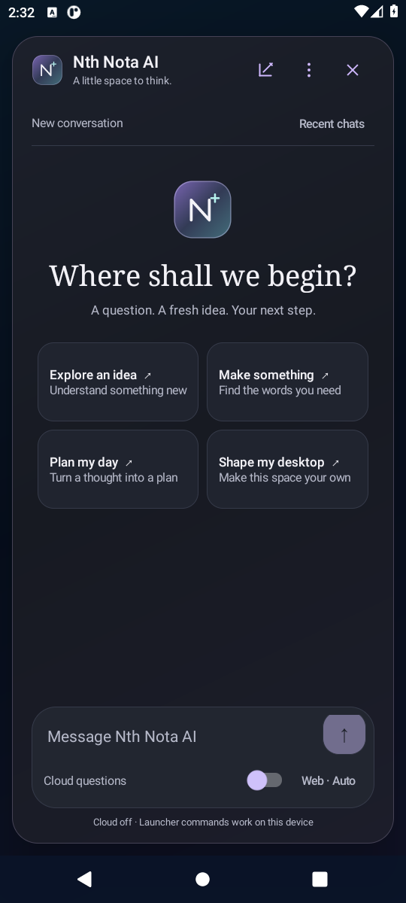
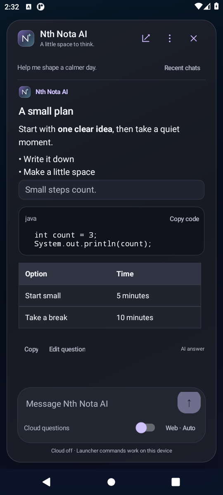

# Nth Nota AI studio — 0.9.7

This is the **AI assistant inside Nth Desktop 3D**, separate from the standalone **Nth Nota** notes project. Version 0.9.7 / code 10112 continues the 0.9.6 conversation trial.

## Interface

An opaque graphite canvas, original Nth letter-and-spark artwork, lilac/ice accents and a serif welcome heading give the assistant its own identity. Native Android views render the entire interface; no web chat, web fonts or remote artwork is loaded. Launcher transparency does not show desktop icons through conversation text.

The dedicated header contains New conversation, the conversation menu and Close. Recent chats and the current title appear in taller viewports. The menu also returns to launcher settings. Short viewports hide secondary chrome to preserve space for the independently scrolling conversation and fixed composer.

Four welcome cards insert drafts without sending. User messages appear in right-aligned bubbles; assistant prose is flat and selectable. Native formatting supports headings, emphasis, lists, quotes, fenced code and comparison tables. Code and wide tables scroll horizontally. Copy code retains code whitespace; Copy retains the complete original reply. HTML and image syntax remain literal text and cannot execute or load remote content. This is a limited Markdown renderer, not a full Markdown or HTML engine.

Source cards show their title and host and open the existing validated source URL. The footer retains the answer kind and source-check time; accessibility exposes the complete date/time. Edit question inserts a draft without sending. The existing bounded device-local conversation store is retained. Nothing here reads the standalone notes app.

The multiline composer keeps Send/Stop, Cloud questions and Web Auto/Always controls above the keyboard. Long completed replies open near their beginning rather than below the answer at its source/action footer. Reading older messages during a request preserves the reader's position; Latest returns to the transcript end.

## Scope

No Worker, provider, model, variant setting, endpoint, request schema, quota or billing configuration changes. Existing local commands, cloud consent, cancellation, follow-up boundaries and validated sources remain. The consent wording includes explicitly requested page reading alongside search. This update does not add token streaming, voice, attachments or model-executed launcher actions.

## Implementation

| File | Responsibility |
| --- | --- |
| `NotaChatView.java` | Header, welcome, transcript, history, sources, draft and composer |
| `NotaDesign.java` | Palette, controls and original resolution-independent mark |
| `NotaMarkdown.java` | Literal-first block parser without Android dependencies |
| `NotaReplyView.java` | Native text, copyable code and comparison tables |
| `SettingsStudio.java` | Lifecycle, navigation and existing local/cloud dispatch |
| `Ui.java` | Opaque reading surface |
| `AppCatalog.java`, `CrystalCards.java`, `SettingsModel.java` | Consistent Nth Nota AI entry-point naming |

## Verification

Application commit: `b7926709ae2584527933f5246bbd5fdb499cadcf`. Source tree: `83ac204de54de1df90b351ca938087e2fdf67486`; application tree: `59c477040064871ca7588e4680d7b713ad78a548`. CI integration commit `4c4db85b460010dd3364ec1c5f6780a7bc349f48` has the identical source tree.

[Final CI run](https://github.com/bdredenbach/Nth-Desktop-3D/actions/runs/44751644061) passes all four builds, lint and JVM checks. Five new JVM cases cover lists/quotes, exact code whitespace, incomplete fences, table boundaries and literal HTML/image text. Live-source, polish, interaction, crystal, cards, realism, presets, drawer, folders, packs, placement and adaptive suites also pass on this application source. Core, anchors, workspace, widgets and settings have broader failures; the earlier settings-rotation failure remains. A full launcher or physical-device pass is not claimed.

The previous complete focused Nota passes at `5db716b` and `af4c0bb` cover saved/new chats, context boundaries, local/cloud separation, sources, opt-out cancellation, reopening, rotation, keyboard visibility, opaque reading pixels, code copying, tables, draft-only editing and settings navigation. Their native screenshots were inspected. The first final-layout attempt aborted when Android's system-server watchdog killed a WindowManager screenshot capture. The isolated final retry passed on a fresh emulator: job `136348007695`, native artifact `14636623203`, with zero failures/errors. Portrait, landscape, welcome, conversation, keyboard and formatted-reply screenshots from that final revision were opened and inspected.

## APK status

The exact unsigned Google-enabled artifact is `14635946609` from the final CI run. Archive SHA-256: `c4e2ed8544180f36bbdb48385213aade93ca05640b536400bf671730db79027f`. It is retained in GitHub Actions for signing; it is not an installable update.

An update APK must reuse the owner's permanent R2 certificate. Its private backup was absent from this resumed workspace and could not be located among available saved files. No replacement key was generated. The previous signed 0.9.6 APK is available for the eventual in-place package/certificate/version comparison. A CI debug key cannot replace the installed owner's update identity.

## Final native previews

These are unedited emulator screenshots of the tested application source, using synthetic conversation fixtures.

